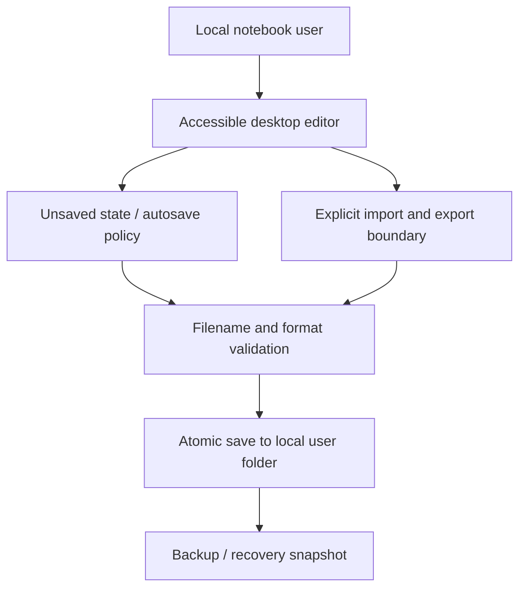

# Notbox — Python / Windows Notebook Application Engineering — Reference Architecture

## What is known

The public repository describes notebook tooling for Python and Windows. It contains no distributable application source, format specification or published Windows executable.

## Engineering question

A local notebook must protect user drafts during crashes, support predictable saves/exports and prevent unsafe execution or accidental exposure of local content.

## Illustrative flow (not a production diagram)

## Design invariants and risk controls

- Write via temporary file and atomic rename where supported; do not overwrite the only good copy on failure.
- Respect Windows path and encoding rules, Unicode text, line endings and locked files.
- Local content is private by default; synchronization or telemetry must be explicit opt-in.
- Never execute untrusted notebook content as Python without a separate sandboxed, permission-scoped mechanism.

## Synthetic scenario to test in future

Synthetic save test: simulate interrupted write, restart, recover previous draft and verify UTF-8 Persian text and attachments remain intact.

## Failure mode / trade-off

A successful UI save notification before durable write is completed can mask data loss.

## Evidence required before confirming features

- A versioned implementation artifact or test contract, reviewed against original source.
- A deterministic fixture that exercises negative permissions, errors and recovery.
- A dated CI run linked to the fixture rather than to documentation formatting alone.
- Authorized sanitized images/measurements; never actual account or customer data.

This file should be updated when real evidence becomes publishable; until then these are **design notes only**. See [README.md](README.md) and [ROADMAP.md](ROADMAP.md).
